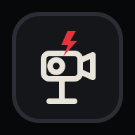
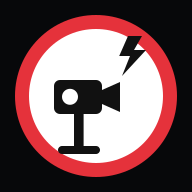

# Propositions d'icône radar — carte GPS Igor

Quatre styles possibles pour remplacer l'icône actuelle (disque blanc, liseré rouge, appareil photo noir). Tout reste dessiné en canvas dans `gpsPoiIcons()` — aucune image à héberger.

| 1 · Panneau officiel | 2 · Style Igor |
|---|---|
|  |  |
| Le panneau carré « contrôle automatique », le plus reconnaissable. | Tuile sombre, trait fin blanc cassé, étincelle rouge. Le plus cohérent avec la charte. |

| 3 · Disque rouge | 4 · Panneau flash |
|---|---|
|  |  |
| Le plus visible de loin, style « alerte » assumé. | Rond blanc à liseré rouge avec éclair, façon signalisation européenne. |
